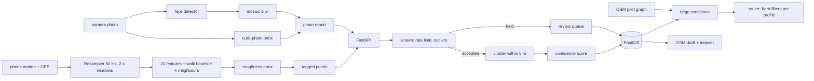

# Architecture

One page. The README has the stories; this is the map.

## Three places things run

**The phone** (`web/src/lib`). Everything that touches a sensor or a photo runs in the browser through onnxruntime-web, behind one `Runner` interface so tests run the same model files with onnxruntime-node. `Recorder` owns a session: `Resampler` puts jittery device events on an exact 50 Hz grid, `WalkClassifier` builds the model input (features of the window, the same features relative to the walk's running median, and a few from the windows either side) and answers one window late. The GPS trace never leaves the device. `selectTaggedPoints` decides what is offered for upload. A photo is classified, then faces are found and replaced by a three-cell mosaic, then re-encoded through a canvas, which drops EXIF.

**The API** (`api/curbcut`). `Service.submit` is the only way in: `abuse.check_rate`, `abuse.screen`, then `_attach` puts an accepted report into the nearest same-category feature within 5 m or starts one, and `rescore` recomputes position, state, confidence and publication from the feature's reports. `Store` is a protocol with two implementations, `MemoryStore` and `PostgisStore` (geography points, `ST_DWithin` for the cluster lookup). The same tests run against both.

**Offline** (`ml/`, `scripts/`). The simulator, training and evaluation for both models, the Commons fetcher and the pilot-area builder. None of it is needed at run time: the three ONNX files and the pilot extract are committed.

## Confidence

One vote per device (its latest report in the cluster). `weight = source x model confidence x GPS accuracy x 0.5^(age / half life)`. `confidence = agreement x (1 - exp(-support / 2))`, where support is the weight behind the winning state and agreement is its share of all weight. One perfect vote gives 0.39, under the 0.5 publishing threshold by construction. Two photo votes or three sensor votes that agree clear it. A blocked ramp has a 14 day half life, a missing curb cut a year.

## Routing

The graph is 991 real footway edges with OSM kerb, surface and steps tags and an incline from a 1 m lidar DEM. `build_conditions` snaps features to edges: published ones become facts, unpublished ones only a cost penalty. `judge(edge, condition, profile)` returns passable or not, with a reason. Dijkstra runs only over passable edges, so a barrier cannot be crossed by being cheap. The unconstrained shortest walk is returned alongside with the barriers it crosses, and when no route exists the answer is `no_accessible_route` with no line to follow.

## Invariants

- A lone report never publishes. A reviewer can publish or retract a feature, and that is recorded on the feature, not as a vote.
- Synthetic stays labelled from report to feature to export.
- Nothing writes to OpenStreetMap. The export is an OsmChange file of `<modify>` elements that a person approved one by one.
- The feature code in TypeScript and Python gives the same numbers, checked by a shared fixture.

## Decisions I would revisit

- Clustering is leader-based (join the nearest feature within 5 m), so the result depends on arrival order and two features can drift to within 5 m of each other without merging.
- One process-wide lock serialises intake. More than one API process needs a Postgres advisory lock instead.
- Device identity is a random id the phone made up. It rate-limits honest clients and does nothing against someone who mints ids.
