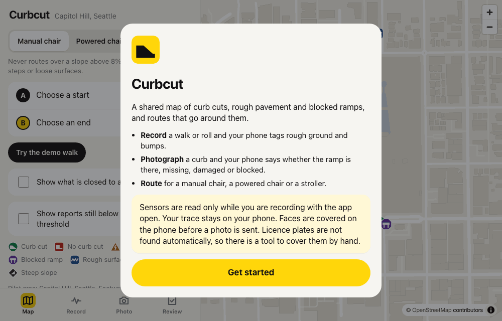
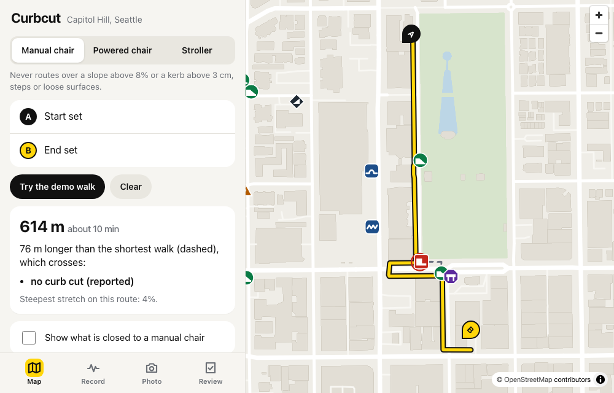
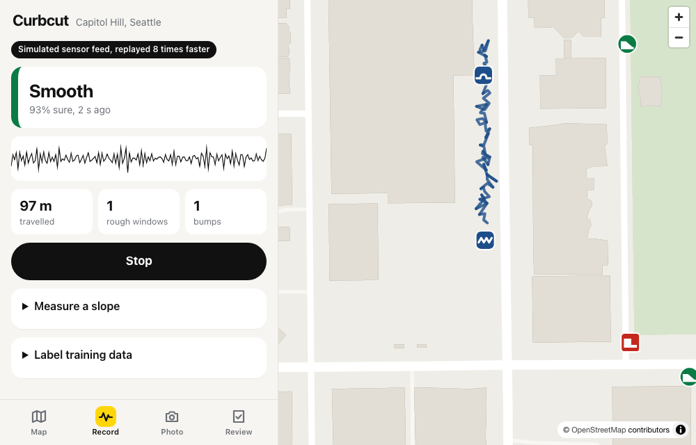
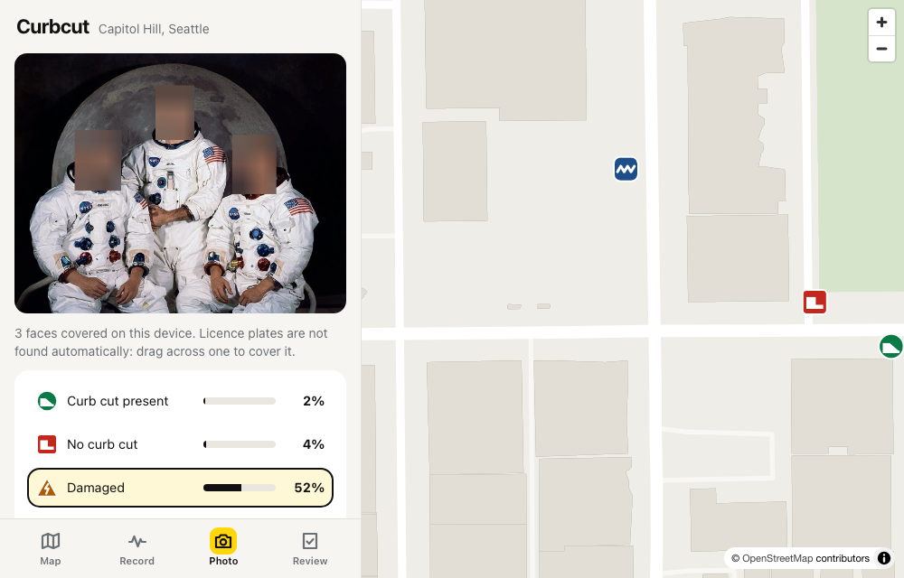

<div align="center">

# Curbcut

### a shared map of where the sidewalk stops working, and routes that go around it

[](api)
[](web)
[](web/public/models)
[](#acceptance-tests)
[](api/tests)
[](LICENSE)

<br>



</div>

<br>

> **Two of this project's four acceptance tests are not met, and I would rather you read that here than discover it.** The routing and the report aggregation work and are tested hard. Both machine learning models fall short of their 85% targets, one of them on simulated data. The app has also never run on a physical phone. Details are in [Acceptance tests](#acceptance-tests), with nothing rounded up.

A curb with no ramp is a wall if you use a wheelchair. Maps do not know where those walls are, because the people who meet them have no easy way to say so.

Curbcut is a progressive web app with two ways of saying so. Leave it open while you walk or roll, and the phone's accelerometer tags rough ground and sudden bumps along your trace. Or photograph a curb, and a small model on the phone decides whether the ramp is there, missing, damaged or blocked. Reports from different people are merged into features with a confidence score. Once a feature clears the bar it changes the routes the app gives to wheelchairs and strollers.

<p align="center"></p>
<p align="center"><sub>Capitol Hill, Seattle. The dashed line is the shortest walk. The yellow one is 76 metres longer and does not ask a wheelchair to climb a curb.</sub></p>

<br>

## Table of contents

- [Run it](#run-it)
- [What is real and what is pretend](#what-is-real-and-what-is-pretend)
- [Feeling the pavement](#feeling-the-pavement)
- [Reading a curb](#reading-a-curb)
- [From reports to a route](#from-reports-to-a-route)
- [Giving it back to OpenStreetMap](#giving-it-back-to-openstreetmap)
- [The parts that fought back](#the-parts-that-fought-back)
- [Acceptance tests](#acceptance-tests)
- [Limitations](#limitations)
- [Next](#next)
- [Layout and credits](#layout-and-credits)

<br>

## Run it

```bash
git clone https://github.com/ayaan-gupta/curbcut && cd curbcut && make up
```

Open http://localhost:4109 and press "Try the demo walk". Docker is the only requirement.

`make up` builds two images and runs three containers: the web app on 4109, the API on 8109 and PostGIS on 5509, each published on 127.0.0.1 only. `make down` stops them and keeps the data. A `docker-compose.yml` describing the same services is in the repo, but the build machine had no compose plugin, so it is untested and the Makefile is what I actually ran.

For development, `make dev` runs the API with reload beside Vite, and `make test` runs everything.

To try it on a real phone you will need an HTTPS tunnel to port 4109. Browsers only hand motion sensors and the camera to a secure context, and I chose not to open any port to the local network by default.

<br>

## What is real and what is pretend

A crowdsourced map that quietly mixes invented data with real data is worse than no map. So the line is drawn in code as well as in this table.

| Real | Stand-in, and labelled as such in the app |
|---|---|
| The street graph: 991 footway edges and 256 mapped curbs from OpenStreetMap | Every report on the demo map, seeded onto those real curbs |
| Incline, from the USGS 1 metre lidar elevation model | The sensor feed, which is a simulated walk when a device has no motion sensors |
| 268 minutes of real gait recordings, for training and a held-out check | The roughness model's headline score, measured on simulated walks |
| 884 real photos from Wikimedia Commons, 226 of which show a curb clearly enough to use | The labels on those photos, which were assigned by AI models and checked by no person |
| Three ONNX models running in the browser | Two bundled sample photos |

Anything synthetic carries a flag from the moment it is created, and every feature built from it inherits the flag. The OpenStreetMap draft leaves flagged features out. Ask it to include them anyway and the file it writes is named `SYNTHETIC-do-not-upload`.

<br>

## Feeling the pavement

<p align="center"></p>

The PRD specifies the recipe: sample the accelerometer at 50 Hz, cut it into 2 second windows, compute features such as vertical RMS and spectral band energy, and classify each window as smooth, rough or bump. I used gradient-boosted trees exported to ONNX, 372 kB, run by onnxruntime-web on the phone. Your GPS trace never leaves the device. Only the tagged points are uploaded.

It also asks for a model trained on at least 200 windows collected by hand. I have no phone to walk with and no wheelchair to roll, so I built two substitutes and was careful to keep track of which is which.

The first is a simulator of walking and rolling over three kinds of ground. The second is real: a CC0 research dataset of thirty people walking on flat paving and on cobblestones while wearing inertial sensors (Luo et al., 2020). Those are research sensors strapped to the body. Nobody in that dataset is on wheels and there is no bump class in it.

| Evaluated on | Macro F1 |
|---|---|
| 40 held-out **simulated** walks, three classes | 0.833 |
| Real held-out people, smooth against cobblestone only | 0.712 |
| A model trained on simulation alone, on those same real people | 0.628 |
| A model trained on the real windows alone, on those same real people | 0.733 |

Read the bottom three rows together. Simulation by itself transfers poorly, and adding real data helps. Even so, a model that sees nothing but real data tops out near 0.73, which suggests that for a person on foot, cobblestones and flat paving simply do not feel very different to an accelerometer. Real cobblestone raised vertical RMS by only 17%.

The signal ought to be stronger on wheels, where there is no gait to hide the bumps. That is the half with no real data behind it at all.

The app includes a collection mode that exports labelled windows, and `ml/roughness/retrain.py` retrains from such an export. The acceptance test as the PRD meant it is one afternoon with a wheelchair away.

<br>

## Reading a curb

A MobileNetV3-Small, fine-tuned to four classes and exported to ONNX at 6.1 MB, runs in the browser. Before a photo is shown or sent, a face detector runs on the device and replaces every face with a coarse mosaic.

<p align="center"></p>
<p align="center"><sub>Three faces covered on the device. The photo is NASA's Apollo 11 crew portrait, used because it is public domain. Note the classifier's opinion of it, which I come back to below.</sub></p>

The PRD demands evaluation on real photos with no synthetic images in the test set, and `assert_real` in the dataset code refuses to evaluate on anything else. The photos came from Wikimedia Commons, with a manifest recording the source page, author, licence and checksum of every file. They are fetched by script and are not committed.

Here is the uncomfortable part. Somebody has to label those photos, and no person did. The labels were assigned by the AI agent that built this project and by two AI helpers, looking at thumbnails. A spot check of 31 photos by a second pass agreed on 26. So every accuracy figure below means "agreement with model-assigned labels" and nothing stronger.

| Trained on | Validation, 27 photos | Test, 80 photos |
|---|---|---|
| Real photos only | 77.8% | 73.8% |
| Real plus 1,200 procedural scenes (shipped) | 81.5% | **70.0%** |
| Procedural scenes only | | 22.5% |

The shipped model is the middle row because I fixed the selection rule before looking at the test set: best on validation wins. With 27 validation photos that rule is close to a coin flip, and it picked the model that turned out three photos worse on test. I left it that way. Swapping models after seeing test results is how a test set stops being one.

Where it goes wrong: nine of the seventeen "missing" photos in the test set are called "present". It also has no "this is not a curb" class, which is why three astronauts came out as a damaged ramp.

Licence plates are not detected. The PRD asks for it, and what exists is a tool for covering one by hand and a sentence in the app admitting as much.

<br>

## From reports to a route

**Clustering.** Reports of the same kind within 5 metres merge into one feature.

**Confidence.** A score built from how many independent reporters agree, discounted with age. A feature publishes at 0.5. The formula is tuned so that one report can never get there by itself: a lone report with perfect model confidence scores 0.39.

**Anti-abuse.** Per-device rate limits come first. Reports with poor GPS accuracy or an impossible speed are rejected, and whatever still looks odd waits in a review queue.

**Routing.** The three profiles are hard filters, as the PRD specifies. A manual chair will not be routed over a slope above 8%, a curb above 3 cm, steps or loose surfaces. When the filters leave no path, the app says "no accessible route" and draws nothing, because a hopeful line across a barrier is worse than an honest refusal.

This half of the project is the solid half. On the real street graph, the routing test marks a fifth of all crossings as having no curb cut and runs 300 random trips, comparing each answer against an independent flood fill. Every returned route avoids every marked segment, and a route is returned exactly when the flood fill says one exists.

<br>

## Giving it back to OpenStreetMap

The PRD wants verified features contributed back as `kerb=lowered`, `kerb=flush`, `surface` and `incline` tags, through a reviewed workflow.

Curbcut produces an OsmChange draft containing only the edits a reviewer has approved on the review screen. It then stops. No code in this repository talks to the OpenStreetMap editing API, and a test greps the source to keep it that way. Uploading to a shared map is a decision for a person with an OSM account and a changeset comment, and automated edits have their own community rules that a weekend project should not presume to satisfy.

The full dataset also exports as GeoJSON under ODbL 1.0.

<br>

## The parts that fought back

**My simulator was too clean, and fixing it cost me the target.** I compared simulated walkers against the real lower-back sensor one feature at a time. The simulated 3 to 8 Hz band carried about 28 times less power than real gait. Real walking is dominated by heel strike, with broadband energy up to 20 Hz. Mine was very nearly a sine wave. Three passes later the medians were within 20% or so, and a classifier trained on the more truthful simulator scored 0.796 where the naive one had flattered itself.

**Context bought five points back, with an asterisk.** People differ from each other far more than rough ground differs from smooth under one person. So I added features relative to the walk's own running median, and more from the windows on either side: a jolt between calm neighbours is a bump, and the same jolt between noisy ones is rough ground. That took the simulation-only model to 0.846. In the same change I also tidied the simulator's definition of a bump, so part of that gain is an easier exam and I cannot say how much.

**Reading 5% of a 2 GB zip.** The gait dataset is a single 2.04 GB archive. I handed Python's `zipfile` a file object backed by HTTP range requests. It read the 1.4 MB central directory and then fetched only the 1,080 members it needed, 138 MB in all.

**A walk uploaded in one batch looked like teleporting.** Every point in a batch was stamped with the server's clock, so twelve points 20 metres apart arrived "in the same second" and the speed check sent eleven of them to review. Reports now carry two times. When the phone observed it feeds the speed check. When the server received it feeds the rate limit, so backdating a report cannot dodge the limit.

**A blurred face was still a face to the detector.** My first mosaic was four cells across. I ran the detector again on the result, as a test, and it still fired on one of the three astronauts. At three cells it finds none, and that is now the assertion: blur, detect again, expect nothing.

**GPS jitter tripled the distance.** The record screen claimed 415 metres for a 149 metre simulated roll, because two metres of noise once a second adds up. A fix now only counts when it is 8 metres from the last one counted.

And one I am not proud of: I typed a made-up checksum for the face model into a script before I had downloaded the file. I caught it and replaced it with the measured one, and the script now refuses any file that does not match.

<br>

## Acceptance tests

| PRD test | Result | Measured |
|---|---|---|
| Roughness classifier reaches at least 85% macro F1 on a held-out walk | **Not met** | 0.833, and that is on simulated walks. On real held-out people, 0.712 over two classes. No labelled phone walk exists. |
| Photo classifier reaches at least 85% accuracy on real photos with no synthetic images | **Not met** | 70.0% on 80 real photos, 95% interval 59 to 79%. The majority-class baseline is 47.5%. Labels are model labels. |
| Two reports within 5 m merge, and a lone low-confidence report does not publish | Met | Reports 3.9 m apart become one feature. 8 m apart stay separate. A lone report tops out at 0.39 against a 0.5 threshold. Tested on the memory store and on PostGIS. |
| Wheelchair route never crosses "no curb cut" when an alternative exists | Met | 300 random trips on the real graph, checked against an independent flood fill, plus the case with no alternative. |

The two misses are encoded in the test suite as strict expected failures. The suite passes with the misses visible in its report. If a retrained model ever clears 85%, the test fails until someone updates the claim. That seemed more honest than deleting the tests or loosening the numbers.

<br>

## Limitations

- **It has never run on a physical phone.** The sensors and the camera were exercised through a simulated feed and bundled photos in headless Chromium.
- **Neither model meets its target,** as set out above. The roughness model is also brittle outside what the simulator produces. A hand-made signal of a still phone with one sharp jolt was classified as smooth.
- **Photo labels came from AI models.** Until people label that set, its accuracy numbers are provisional.
- **"Independent reporters" is only as good as the device id,** which is a random value made on the phone. Rate limits stop honest clients and do nothing against someone minting ids.
- **Review and export endpoints are open** unless a reviewer token is set. There are no accounts.
- **GPS in a street canyon is often worse than the 5 metre clustering radius.** Two honest reports of one curb can land in two clusters.
- **Incline is known for 355 of the 991 edges.** Unknown incline is treated as passable, which errs in the dangerous direction.
- **The OSM draft can only change tags on things that already exist.** It cannot add a new curb node, and a surface edit applies to a whole way.
- **Photo reports need a connection.** There is no offline upload queue.
- **One pilot area.**

<br>

## Next

1. Collect the real 200 windows with the built-in collection mode on a wheelchair and a stroller, retrain, and report leave-one-session-out macro F1. That is the acceptance test as written.
2. Have people label the photo set. The contact sheets and manifest are ready. Add a "not a curb" class while doing it.
3. Replace the self-issued device id with platform attestation or a signed-in contributor, so that "independent" starts to mean something.

<br>

## Layout and credits

```
api/curbcut/       FastAPI: intake, clustering, confidence, abuse checks, routing, the OSM draft
ml/roughness/      simulator, calibration against real gait, features, training, evaluation
ml/photo/          Commons fetcher and licence manifest, procedural scenes, training, evaluation
web/               React PWA: map, record, photo and review tabs, with the models in the browser
data/pilot/        the committed OpenStreetMap extract for Capitol Hill with lidar incline
scripts/           the Docker stack and the pilot builder
assets/            prompts.md (image requests), interim/ (hand-written SVG pictograms)
```

[ARCHITECTURE.md](ARCHITECTURE.md) has the data flow on one page. The seven map icons were designed to stay legible at 24 pixels and are hand-written SVG. Final versions are requested in [assets/prompts.md](assets/prompts.md), since the brief does not let me generate images.

Map data is © [OpenStreetMap](https://www.openstreetmap.org/copyright) contributors, under ODbL. Elevation is from the USGS 3D Elevation Program. The gait recordings are from Luo, Coppola, Dixon, Li, Dennerlein and Hu, [*A database of human gait performance on irregular and uneven surfaces collected by wearable sensors*](https://doi.org/10.6084/m9.figshare.c.4892463), Scientific Data 7:219 (2020), CC0. Curb photos are by Wikimedia Commons contributors under the licences listed per file in `ml/photo/manifest.json`. The face detector is Linzaer's Ultra-Light-Fast-Generic-Face-Detector (MIT), and the photo backbone is torchvision's MobileNetV3-Small.

## License

MIT for the code. See [LICENSE](LICENSE). The exported dataset is ODbL 1.0.
